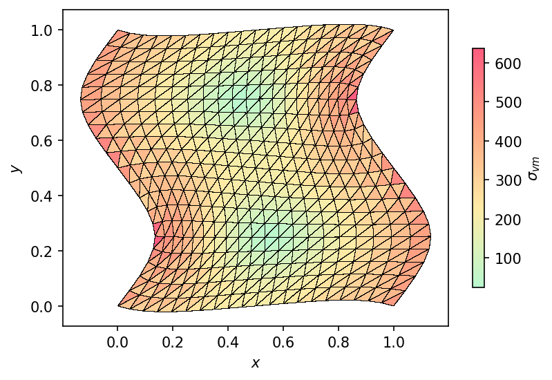
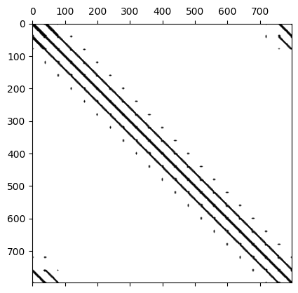
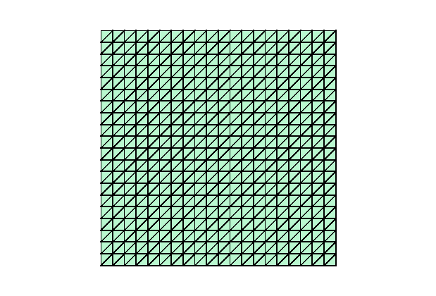

<div class="nb-header"><a href="https://colab.research.google.com/github/smec-ethz/tatva-docs/blob/main/notebooks/examples/periodic.ipynb" target="_blank"></a><a href="/assets/notebooks/examples/periodic.ipynb" download="periodic.ipynb" class="nb-download-btn"><svg class="nb-download-icon" viewBox="0 0 24 24" xmlns="http://www.w3.org/2000/svg"><path d="M12 16l-6-6 1.41-1.41L11 13.17V4h2v9.17l3.59-3.58L18 11l-6 6z"/><path d="M5 18h14v2H5z"/></svg> Download</a></div>

# Matching & Non-matching periodic BCs

This example showcases simple periodic boundary conditions.


```python
from tatva import Mesh, Operator
from tatva.compound import Compound, field
from tatva.lifter import Lifter, Fixed, Periodic
from tatva import sparse

import jax
import jax.numpy as jnp


import matplotlib.pyplot as plt
from matplotlib.tri import Triangulation

jax.config.update("jax_enable_x64", True)
```


??? example "Color scheme for plots"
    ```python
    
    
    # just a custom color scheme for plots
    from matplotlib.colors import LinearSegmentedColormap
    
    tatva_colors = {
        "green": "#b9f8cf",  # Low stress
        "yellow": "#ffeba5",  # Mild stress
        "orange": "#ffa683",  # Moderate stress
        "pink": "#ff5d7f",  # High stress
    }
    
    color_list = [
        tatva_colors["green"],
        tatva_colors["yellow"],
        tatva_colors["orange"],
        tatva_colors["pink"],
    ]
    
    tatva_cmap = LinearSegmentedColormap.from_list("tatva_stress", color_list, N=256)
    ```

### Simple physics for this example

Basic Neo-hookean elasticity


```python
from jax import Array
from jax_autovmap import autovmap
from typing import NamedTuple
import numpy as np


class Material(NamedTuple):
    """Material properties for the elasticity operator."""

    mu: float  # Diffusion coefficient
    lmbda: float  # Diffusion coefficient

    @classmethod
    def from_youngs_poisson_2d(
        cls, E: float, nu: float, plane_stress: bool = False
    ) -> "Material":
        mu = E / 2 / (1 + nu)
        if plane_stress:
            lmbda = 2 * nu * mu / (1 - nu)
        else:
            lmbda = E * nu / (1 - 2 * nu) / (1 + nu)
        return cls(mu=mu, lmbda=lmbda)


@autovmap(grad_u=2)
def compute_deformation_gradient(grad_u: Array) -> Array:
    return jnp.eye(2) + grad_u


@autovmap(grad_u=2, mat=None)
def strain_energy_density(grad_u: Array, mat: Material) -> Array:
    F = compute_deformation_gradient(grad_u)
    C = F.T @ F
    J = jnp.linalg.det(F)
    return (
        mat.mu / 2 * (jnp.trace(C) - 2)  # 2D case
        - mat.mu * jnp.log(J)
        + (mat.lmbda / 2) * (jnp.log(J)) ** 2
    )


@autovmap(grad_u=2, mat=None)
def get_cauchy_stress(grad_u: Array, mat: Material) -> Array:
    F = compute_deformation_gradient(grad_u)
    C = F.T @ F
    J = jnp.linalg.det(F)

    C_inv = jnp.linalg.inv(C)
    S = mat.mu * (jnp.eye(2) - C_inv) + mat.lmbda * jnp.log(J) * C_inv  # 2nd PK
    P = F @ S  # 1st PK

    sigma = (P @ F.T) / J  # Cauchy
    return sigma


@autovmap(grad_u=2, mat=None)
def get_stress(grad_u: Array, mat: Material) -> Array:
    # 2nd Piola-Kirchhoff stress tensor
    F = compute_deformation_gradient(grad_u)
    C = F.T @ F
    J = jnp.linalg.det(F)
    C_inv = jnp.linalg.inv(C)
    S = mat.mu * (jnp.eye(2) - C_inv) + mat.lmbda * jnp.log(J) * C_inv  # 2nd PK
    return S


def von_mises_stress(sig):
    s_xx, s_yy, s_xy = sig[..., 0, 0], sig[..., 1, 1], sig[..., 0, 1]
    return np.sqrt(s_xx**2 - s_xx * s_yy + s_yy**2 + 3 * s_xy**2)

```

## Matching boundaries

### 1. Define mesh & Lifter

For matching boundaries, we can use the built-in `Periodic` constraint.


```python
n = 20
mesh = Mesh.unit_square(n, n)


class Solution(Compound, mesh=mesh):
    u = field((-1, 2))


bottom = jnp.where(jnp.isclose(mesh.coords[:, 1], 0))[0]
top = jnp.where(jnp.isclose(mesh.coords[:, 1], 1))[0]
right = jnp.where(mesh.coords[:, 0] == 1)[0]
left = jnp.where(mesh.coords[:, 0] == 0)[0]
corner_0 = jnp.where((mesh.coords[:, 0] == 0) & (mesh.coords[:, 1] == 0))[0]

lifter = Lifter(
    mesh.coords.shape[0] * 2,
    Fixed(Solution.u[corner_0]),
    Periodic(Solution.u[right, :], Solution.u[left, :]),
    Periodic(Solution.u[top, :], Solution.u[bottom, :]),
)
```

### 2. Functionals & Differentiation


```python
from tatva.element.base import Tri3


def energy_functional(
    z: Array,  # flat array of reduced dofs
    op: Operator,  # fem operator
    lifter: Lifter,  # lifting operator
    mat: Material,
) -> Array:
    z_full = lifter.lift_from_zeros(z)  # lift operation
    (u,) = Solution(z_full)  # reshape flat array into fields
    grad_u = op.grad(u)
    psi = strain_energy_density(grad_u, mat)
    return op.integrate(psi)


op = Operator(mesh, Tri3())
mat = Material.from_youngs_poisson_2d(1e3, 0.3)
sparsity = sparse.pattern_from_energy(
    energy_functional, lifter.size_reduced, op, lifter, mat
)
colored_matrix = sparse.ColoredMatrix.from_csr(sparsity)

load_left = jnp.sin(jnp.pi * 2 * mesh.coords[left, 1]) * 1e2 * (10 / n)

gradient = jax.grad(energy_functional)


def residual(
    z: Array, load: Array, op: Operator, lifter: Lifter, mat: Material
) -> Array:
    return gradient(z, op, lifter, mat) - load


jac = sparse.jacfwd(residual, colored_matrix)
```

### 3. Solve (using `soldis`)

See https://github.com/smec-ethz/soldis


```python
from soldis import newton, linear

solver = newton.NewtonSolver(
    jax.jit(residual),
    linear.SparseTatva(),
    jax.jit(jac),
    maxiter=20,
    tol=1e-8,
    verbose=True,
)

z_f_0 = jnp.zeros(lifter.size_reduced)
load = lifter.reduce(jnp.zeros(lifter.size).at[Solution.u[left, 0]].set(load_left))
sol = solver.root(z_f_0, load, op, lifter, mat)
```

    Iteration 0/20; Residual 158.11388300841898
    Iteration 1/20; Residual 50.31942815444444
    Iteration 2/20; Residual 5.392982160758012
    Iteration 3/20; Residual 0.055561218024660665
    Iteration 4/20; Residual 8.541463917842835e-06
    Iteration 5/20; Residual 4.409854234892971e-13


```python
(u_sol,) = Solution(lifter.lift_from_zeros(sol.value))

x_sol = u_sol + mesh.coords
tri = Triangulation(x_sol[:, 0], x_sol[:, 1], mesh.elements)

fig, ax = plt.subplots(figsize=(6, 6), dpi=150)
ax.set_aspect("equal")

sig = get_cauchy_stress(op.grad(u_sol), mat)
vm = von_mises_stress(sig)
cb = ax.tripcolor(
    tri, vm.flatten(), color="k", cmap=tatva_cmap, lw=0.01, rasterized=True
)
ax.set(xlabel="$x$", ylabel="$y$")
plt.colorbar(cb, shrink=0.5, label="$\\sigma_{vm}$")
plt.show()
```


    

    


## Non-matching boundaries

For non-matching boundaries, a simple node-to-node coupling is not possible. In this case, we constrain the dofs on the right edge to be the interpolated value at $x - 1$.

To do this in `tatva` you create a small custom constraint.


??? example "Mesh Generation"
    ```python
    
    import gmsh
    
    
    def get_mesh(n_1: int = 10, n_2: int = 20):
        gmsh.model.add("tatva_non_matching_square")
    
        # 1. Define Geometry Points (Unit Square)
        lc = 1.0  # Base characteristic length (will be overridden by transfinite specs)
        p1 = gmsh.model.geo.addPoint(0.0, 0.0, 0.0, lc)
        p2 = gmsh.model.geo.addPoint(1.0, 0.0, 0.0, lc)
        p3 = gmsh.model.geo.addPoint(1.0, 1.0, 0.0, lc)
        p4 = gmsh.model.geo.addPoint(0.0, 1.0, 0.0, lc)
    
        # 2. Define Curves
        # c_bottom: y=0, c_right: x=1, c_top: y=1, c_left: x=0
        c_bottom = gmsh.model.geo.addLine(p1, p2)
        c_right = gmsh.model.geo.addLine(p2, p3)
        c_top = gmsh.model.geo.addLine(p3, p4)
        c_left = gmsh.model.geo.addLine(p4, p1)
    
        # 3. Create Surface
        curve_loop = gmsh.model.geo.addCurveLoop([c_bottom, c_right, c_top, c_left])
        surface = gmsh.model.geo.addSurfaceLoop([curve_loop])
        # Creating a plane surface automatically sets it up for triangular meshing
        surf = gmsh.model.geo.addPlaneSurface([curve_loop])
    
        gmsh.model.geo.synchronize()
    
        # 4. Enforce Non-Matching Node Counts on Boundaries
        # mesh.setTransfiniteCurve requires total number of nodes (including endpoints)
        # x=0 (c_left)   -> 20 nodes
        # x=1 (c_right)  -> 10 nodes
        # y=0 (c_bottom) -> 20 nodes
        # y=1 (c_top)    -> 10 nodes
        gmsh.model.mesh.setTransfiniteCurve(c_left, n_1)
        gmsh.model.mesh.setTransfiniteCurve(c_right, n_2)
        gmsh.model.mesh.setTransfiniteCurve(c_bottom, n_1)
        gmsh.model.mesh.setTransfiniteCurve(c_top, n_2)
    
        # Note: We do NOT call setTransfiniteSurface. Leaving the surface unstructured
        # allows Gmsh to bridge the 20-to-10 node discrepancy gracefully with triangles.
    
        # 5. Generate Mesh
        gmsh.model.mesh.generate(2)
    
    
    n = 10
    gmsh.initialize()
    get_mesh(n, 3 * n)
    mesh = Mesh(jnp.asarray(mesh.coords), jnp.asarray(mesh.elements))
    gmsh.finalize()
    ```

Info    : Meshing 1D...
    Info    : [  0%] Meshing curve 1 (Line)
    Info    : [ 30%] Meshing curve 2 (Line)
    Info    : [ 60%] Meshing curve 3 (Line)
    Info    : [ 80%] Meshing curve 4 (Line)
    Info    : Done meshing 1D (Wall 0.000210797s, CPU 0s)
    Info    : Meshing 2D...
    Info    : Meshing surface 1 (Plane, Frontal-Delaunay)
    Info    : Done meshing 2D (Wall 0.011578s, CPU 0.017973s)
    Info    : 412 nodes 826 elements


### 1. Define Constraint & Lifter


```python
from tatva.lifter import Constraint
from tatva.element import Tri3

left = jnp.where(jnp.isclose(mesh.coords[:, 0], 0))[0]
right = jnp.where(jnp.isclose(mesh.coords[:, 0], 1))[0]
bottom = jnp.where(jnp.isclose(mesh.coords[:, 1], 0))[0]
top = jnp.where(jnp.isclose(mesh.coords[:, 1], 1))[0]
corner = jnp.where((mesh.coords[:, 0] == 0) & (mesh.coords[:, 1] == 0))[0]


class Solution(Compound, mesh=mesh):
    u = field((-1, 2))


class PeriodicNonMatching(Constraint):
    def __init__(
        self, dofs: Array, map_coords: Array, compound: type[Solution], op: Operator
    ):
        self.dofs = dofs
        self.map_coords = map_coords
        self.compound = compound
        self.interpolate = jax.jit(op.make_interpolate(map_coords))

    def apply_lift(self, u_full: Array) -> Array:
        # Get the solution fields from the full dofs
        (u,) = self.compound(u_full)

        # Interpolate the solution at the mapped coordinates
        u_mapped = self.interpolate(u)

        # Return the lifted solution
        return u_full.at[self.dofs].set(u_mapped.flatten())


op = Operator(mesh, Tri3())

right_to_left = PeriodicNonMatching(
    dofs=Solution.u[right, :],
    map_coords=mesh.coords[right, :]
    - jnp.array([1.0, 0.0]),  # Map right edge to left edge
    compound=Solution,
    op=op,
)

top_to_bottom = PeriodicNonMatching(
    dofs=Solution.u[top, :],
    map_coords=mesh.coords[top, :]
    - jnp.array([0.0, 1.0]),  # Map top edge to bottom edge
    compound=Solution,
    op=op,
)

lifter = Lifter(
    Solution.size,
    Fixed(Solution.u[corner]),
    right_to_left,
    top_to_bottom,
)
```

### 2. Functionals & Differentiation


```python
def energy_functional(
    z: Array,  # flat array of reduced dofs
    op: Operator,  # fem operator
    lifter: Lifter,  # lifting operator
    mat: Material,
) -> Array:
    z_full = lifter.lift_from_zeros(z)  # lift operation
    (u,) = Solution(z_full)  # reshape flat array into fields
    grad_u = op.grad(u)
    psi = strain_energy_density(grad_u, mat)
    return op.integrate(psi)


mat = Material.from_youngs_poisson_2d(1e3, 0.3)
sparsity = sparse.pattern_from_energy(
    energy_functional, lifter.size_reduced, op, lifter, mat
)
colored_matrix = sparse.ColoredMatrix.from_csr(sparsity)

load_left = jnp.sin(jnp.pi * 2 * mesh.coords[left, 1]) * 0.8e2 * (10 / n)

gradient = jax.grad(energy_functional)


def residual(
    z: Array, load: Array, op: Operator, lifter: Lifter, mat: Material
) -> Array:
    return gradient(z, op, lifter, mat) - load


jac = sparse.jacfwd(residual, colored_matrix)
```


```python
plt.spy(sparsity, markersize=0.1, color="black")
```


    <matplotlib.lines.Line2D at 0x7623ac03f8c0>


    

    


### 3. Solve (using `soldis`)


```python
from soldis import newton, linear

solver = newton.NewtonSolver(
    jax.jit(residual),
    linear.SparseTatva(),
    jax.jit(jac),
    maxiter=20,
    tol=1e-8,
    verbose=True,
)

z_f_0 = jnp.zeros(lifter.size_reduced)
load = lifter.reduce(jnp.zeros(lifter.size).at[Solution.u[left, 0]].set(load_left))
root = jax.jit(solver.root)
```


```python
for i in jnp.linspace(0, 1, 40):
    print(f"Solving for load factor: {i:.2f}")
    sol = root(z_f_0, load * i, op, lifter, mat)
    us.append(sol.value)
```

??? info "Output"
    Solving for load factor: 0.00
        Iteration 0/20; Residual 0.0
        Solving for load factor: 0.03
        Iteration 0/20; Residual 6.486723405473599
        Iteration 1/20; Residual 0.08313049503362148
        Iteration 2/20; Residual 1.2783084279232152e-05
        Iteration 3/20; Residual 3.1685261395724405e-13
        Solving for load factor: 0.05
        Iteration 0/20; Residual 12.973446810947198
        Iteration 1/20; Residual 0.3325223577351818
        Iteration 2/20; Residual 0.0002046837778995256
        Iteration 3/20; Residual 5.643872864656622e-11
        Solving for load factor: 0.08
        Iteration 0/20; Residual 19.460170216420796
        Iteration 1/20; Residual 0.7481778786874689
        Iteration 2/20; Residual 0.0010375223366846076
        Iteration 3/20; Residual 1.4632000525673716e-09
        Solving for load factor: 0.10
        Iteration 0/20; Residual 25.946893621894397
        Iteration 1/20; Residual 1.3301047825417083
        Iteration 2/20; Residual 0.0032849326017010184
        Iteration 3/20; Residual 1.4848571243991619e-08
        Iteration 4/20; Residual 2.2158096392976213e-13
        Solving for load factor: 0.13
        Iteration 0/20; Residual 32.43361702736799
        Iteration 1/20; Residual 2.078322254067443
        Iteration 2/20; Residual 0.00803842098236283
        Iteration 3/20; Residual 9.024284121935642e-08
        Iteration 4/20; Residual 2.223967768030717e-13
        Solving for load factor: 0.15
        Iteration 0/20; Residual 38.92034043284159
        Iteration 1/20; Residual 2.992869700173199
        Iteration 2/20; Residual 0.016716148174229138
        Iteration 3/20; Residual 3.968813545365318e-07
        Iteration 4/20; Residual 2.3907944253416977e-13
        Solving for load factor: 0.18
        Iteration 0/20; Residual 45.40706383831519
        Iteration 1/20; Residual 4.073818561165665
        Iteration 2/20; Residual 0.03107469400354964
        Iteration 3/20; Residual 1.3968719256012467e-06
        Iteration 4/20; Residual 2.4000491981559594e-13
        Solving for load factor: 0.21
        Iteration 0/20; Residual 51.89378724378879
        Iteration 1/20; Residual 5.321287557893106
        Iteration 2/20; Residual 0.05322409566097029
        Iteration 3/20; Residual 4.177599383482099e-06
        Iteration 4/20; Residual 2.366399439171015e-13
        Solving for load factor: 0.23
        Iteration 0/20; Residual 58.380510649262376
        Iteration 1/20; Residual 6.735461825052488
        Iteration 2/20; Residual 0.0856464625334059
        Iteration 3/20; Residual 1.1033427554757899e-05
        Iteration 4/20; Residual 4.245512363355855e-13
        Solving for load factor: 0.26
        Iteration 0/20; Residual 64.86723405473597
        Iteration 1/20; Residual 8.316616435028717
        Iteration 2/20; Residual 0.1312184771353674
        Iteration 3/20; Residual 2.6418621302493117e-05
        Iteration 4/20; Residual 2.0621403326208955e-12
        Solving for load factor: 0.28
        Iteration 0/20; Residual 71.35395746020957
        Iteration 1/20; Residual 10.065144862485177
        Iteration 2/20; Residual 0.19323810534965932
        Iteration 3/20; Residual 5.8431636816144275e-05
        Iteration 4/20; Residual 9.896896980197957e-12
        Solving for load factor: 0.31
        Iteration 0/20; Residual 77.84068086568318
        Iteration 1/20; Residual 11.981592979926432
        Iteration 2/20; Residual 0.2754558763821685
        Iteration 3/20; Residual 0.00012103789687594847
        Iteration 4/20; Residual 4.255728545336865e-11
        Solving for load factor: 0.33
        Iteration 0/20; Residual 84.32740427115678
        Iteration 1/20; Residual 14.066699211992804
        Iteration 2/20; Residual 0.3821111699548843
        Iteration 3/20; Residual 0.00023729658261520268
        Iteration 4/20; Residual 1.634852409465898e-10
        Solving for load factor: 0.36
        Iteration 0/20; Residual 90.81412767663038
        Iteration 1/20; Residual 16.321441515578417
        Iteration 2/20; Residual 0.517974081039999
        Iteration 3/20; Residual 0.0004439305568344014
        Iteration 4/20; Residual 5.711010555958984e-10
        Solving for load factor: 0.38
        Iteration 0/20; Residual 97.30085108210396
        Iteration 1/20; Residual 18.747091898982376
        Iteration 2/20; Residual 0.6883936357858323
        Iteration 3/20; Residual 0.0007976723050346406
        Iteration 4/20; Residual 1.8385643518557762e-09
        Solving for load factor: 0.41
        Iteration 0/20; Residual 103.78757448757759
        Iteration 1/20; Residual 21.345279251801543
        Iteration 2/20; Residual 0.8993534212247742
        Iteration 3/20; Residual 0.0013839396117143862
        Iteration 4/20; Residual 5.514077574327447e-09
        Solving for load factor: 0.44
        Iteration 0/20; Residual 110.27429789305117
        Iteration 1/20; Residual 24.11806133427518
        Iteration 2/20; Residual 1.1575360831875567
        Iteration 3/20; Residual 0.002328552240264483
        Iteration 4/20; Residual 1.554412975223533e-08
        Iteration 5/20; Residual 3.0412531482969155e-13
        Solving for load factor: 0.46
        Iteration 0/20; Residual 116.76102129852475
        Iteration 1/20; Residual 27.068006876901663
        Iteration 2/20; Residual 1.4703986645638967
        Iteration 3/20; Residual 0.0038134091304319715
        Iteration 4/20; Residual 4.149573210325537e-08
        Iteration 5/20; Residual 2.8867115943926446e-13
        Solving for load factor: 0.49
        Iteration 0/20; Residual 123.24774470399836
        Iteration 1/20; Residual 30.198288875538086
        Iteration 2/20; Residual 1.8462614332260523
        Iteration 3/20; Residual 0.006097325265730874
        Iteration 4/20; Residual 1.0556633003243035e-07
        Iteration 5/20; Residual 3.0296448505503305e-13
        Solving for load factor: 0.51
        Iteration 0/20; Residual 129.73446810947195
        Iteration 1/20; Residual 33.51279034173737
        Iteration 2/20; Residual 2.2944137366447253
        Iteration 3/20; Residual 0.009543609503216926
        Iteration 4/20; Residual 2.5732713075232414e-07
        Iteration 5/20; Residual 3.3041489314364273e-13
        Solving for load factor: 0.54
        Iteration 0/20; Residual 136.22119151494556
        Iteration 1/20; Residual 37.01622399166775
        Iteration 2/20; Residual 2.8252415969685485
        Iteration 3/20; Residual 0.014656496506232219
        Iteration 4/20; Residual 6.038442960161567e-07
        Iteration 5/20; Residual 3.464649621597498e-13
        Solving for load factor: 0.56
        Iteration 0/20; Residual 142.70791492041914
        Iteration 1/20; Residual 40.71426763990813
        Iteration 2/20; Residual 3.450383346868297
        Iteration 3/20; Residual 0.022129299294079755
        Iteration 4/20; Residual 1.3697426207929823e-06
        Iteration 5/20; Residual 3.197008970159107e-13
        Solving for load factor: 0.59
        Iteration 0/20; Residual 149.19463832589278
        Iteration 1/20; Residual 44.61371741909252
        Iteration 2/20; Residual 4.18292178885995
        Iteration 3/20; Residual 0.032908232914621194
        Iteration 4/20; Residual 3.0146096577400964e-06
        Iteration 5/20; Residual 3.285874463217044e-13
        Solving for load factor: 0.62
        Iteration 0/20; Residual 155.68136173136637
        Iteration 1/20; Residual 48.72266138801562
        Iteration 2/20; Residual 5.037624427492706
        Iteration 3/20; Residual 0.04827743862884125
        Iteration 4/20; Residual 6.458931735138592e-06
        Iteration 5/20; Residual 3.6813798035572237e-13
        Solving for load factor: 0.64
        Iteration 0/20; Residual 162.16808513683995
        Iteration 1/20; Residual 53.050676638614284
        Iteration 2/20; Residual 6.031247725929253
        Iteration 3/20; Residual 0.06997305493145088
        Iteration 4/20; Residual 1.3514110250308889e-05
        Iteration 5/20; Residual 6.908618525529035e-13
        Solving for load factor: 0.67
        Iteration 0/20; Residual 168.65480854231356
        Iteration 1/20; Residual 57.60905369081707
        Iteration 2/20; Residual 7.182927791211837
        Iteration 3/20; Residual 0.10033758559673746
        Iteration 4/20; Residual 2.7695894073293396e-05
        Iteration 5/20; Residual 2.1930375295208517e-12
        Solving for load factor: 0.69
        Iteration 0/20; Residual 175.14153194778717
        Iteration 1/20; Residual 62.411052805576304
        Iteration 2/20; Residual 8.514689546613354
        Iteration 3/20; Residual 0.14253077993377572
        Iteration 4/20; Residual 5.576220463151872e-05
        Iteration 5/20; Residual 8.768712392342793e-12
        Solving for load factor: 0.72
        Iteration 0/20; Residual 181.62825535326076
        Iteration 1/20; Residual 67.47219789236257
        Iteration 2/20; Residual 10.05212118817941
        Iteration 3/20; Residual 0.20082035025101183
        Iteration 4/20; Residual 0.00011063726451258725
        Iteration 5/20; Residual 3.4586366160567605e-11
        Solving for load factor: 0.74
        Iteration 0/20; Residual 188.11497875873437
        Iteration 1/20; Residual 72.81061499328727
        Iteration 2/20; Residual 11.825283687097405
        Iteration 3/20; Residual 0.28098568541587726
        Iteration 4/20; Residual 0.00021704439522629245
        Iteration 5/20; Residual 1.3575362376318545e-10
        Solving for load factor: 0.77
        Iteration 0/20; Residual 194.60170216420792
        Iteration 1/20; Residual 78.44742396532335
        Iteration 2/20; Residual 13.869961645811625
        Iteration 3/20; Residual 0.39088052280504326
        Iteration 4/20; Residual 0.00042258609570908185
        Iteration 5/20; Residual 5.38524483194516e-10
        Solving for load factor: 0.79
        Iteration 0/20; Residual 201.08842556968153
        Iteration 1/20; Residual 84.40719405286623
        Iteration 2/20; Residual 16.229421321738652
        Iteration 3/20; Residual 0.5412155135731709
        Iteration 4/20; Residual 0.0008201854322212426
        Iteration 5/20; Residual 2.186148583244386e-09
        Solving for load factor: 0.82
        Iteration 0/20; Residual 207.57514897515517
        Iteration 1/20; Residual 90.71847667697281
        Iteration 2/20; Residual 18.956941077746666
        Iteration 3/20; Residual 0.7466357531061717
        Iteration 4/20; Residual 0.001595259329842063
        Iteration 5/20; Residual 9.161544066321472e-09
        Solving for load factor: 0.85
        Iteration 0/20; Residual 214.06187238062873
        Iteration 1/20; Residual 97.4144321431925
        Iteration 2/20; Residual 22.11955101602478
        Iteration 3/20; Residual 1.0271755901159216
        Iteration 4/20; Residual 0.003129330350783148
        Iteration 5/20; Residual 3.969804518141352e-08
        Iteration 6/20; Residual 4.955619639911633e-13
        Solving for load factor: 0.87
        Iteration 0/20; Residual 220.54859578610234
        Iteration 1/20; Residual 104.53357132945042
        Iteration 2/20; Residual 25.803726415187153
        Iteration 3/20; Residual 1.410167868045345
        Iteration 4/20; Residual 0.006238846286712514
        Iteration 5/20; Residual 1.7727243777410076e-07
        Iteration 6/20; Residual 5.598183139310335e-13
        Solving for load factor: 0.90
        Iteration 0/20; Residual 227.03531919157595
        Iteration 1/20; Residual 112.12063909143491
        Iteration 2/20; Residual 30.12436258500358
        Iteration 3/20; Residual 1.9326859739303288
        Iteration 4/20; Residual 0.012752848339816839
        Iteration 5/20; Residual 8.113683761840322e-07
        Iteration 6/20; Residual 5.288114592979172e-13
        Solving for load factor: 0.92
        Iteration 0/20; Residual 233.5220425970495
        Iteration 1/20; Residual 120.22767357490689
        Iteration 2/20; Residual 35.239545775698595
        Iteration 3/20; Residual 2.6447424585426127
        Iteration 4/20; Residual 0.026969288745674447
        Iteration 5/20; Residual 3.7795597751847316e-06
        Iteration 6/20; Residual 5.49709151554753e-13
        Solving for load factor: 0.95
        Iteration 0/20; Residual 240.00876600252315
        Iteration 1/20; Residual 128.91528549307915
        Iteration 2/20; Residual 41.37629920105118
        Iteration 3/20; Residual 3.614333438335595
        Iteration 4/20; Residual 0.05942618938010138
        Iteration 5/20; Residual 1.7746871682150075e-05
        Iteration 6/20; Residual 2.396866147663042e-12
        Solving for load factor: 0.97
        Iteration 0/20; Residual 246.49548940799673
        Iteration 1/20; Residual 138.25421461514972
        Iteration 2/20; Residual 48.879274421108654
        Iteration 3/20; Residual 4.93903466828006
        Iteration 4/20; Residual 0.1367621455285638
        Iteration 5/20; Residual 8.30113338237099e-05
        Iteration 6/20; Residual 6.697714351732866e-11
        Solving for load factor: 1.00
        Iteration 0/20; Residual 252.98221281347034
        Iteration 1/20; Residual 148.32723850317365
        Iteration 2/20; Residual 58.31466933854899
        Iteration 3/20; Residual 6.782204967746561
        Iteration 4/20; Residual 0.32762332769149294
        Iteration 5/20; Residual 0.00038407921761161016
        Iteration 6/20; Residual 2.0311064963758895e-09


```python

```

## Visualization


```python
vm_max = 0
for u in us:
    (u_sol,) = Solution(lifter.lift_from_zeros(u))
    sig = get_cauchy_stress(op.grad(u_sol), mat)
    vm = von_mises_stress(sig)
    vm_max = max(vm_max, vm.max())
```


```python
from matplotlib.animation import FuncAnimation, FFMpegWriter

fig, ax = plt.subplots(figsize=(6, 6))
ax.set_aspect("equal")
ax.xaxis.set_visible(False)
ax.yaxis.set_visible(False)
ax.set_frame_on(False)
plt.tight_layout(pad=0)


def frame(i):
    ax.clear()
    ax.set(xlim=(-0.4, 1.4), ylim=(-0.1, 1.1))
    (u_sol,) = Solution(lifter.lift_from_zeros(us[i]))

    x_sol = u_sol + mesh.coords
    tri = Triangulation(x_sol[:, 0], x_sol[:, 1], mesh.elements)

    sig = get_cauchy_stress(op.grad(u_sol), mat)
    vm = von_mises_stress(sig)
    cb = ax.tripcolor(
        tri,
        vm.flatten(),
        color="k",
        cmap=tatva_cmap,
        lw=0.01,
        rasterized=True,
        vmax=vm_max,
    )


ax.set(xlabel="$x$", ylabel="$y$")
animation = FuncAnimation(fig, frame, frames=len(us), interval=500, repeat=True)

webm_writer = FFMpegWriter(
    fps=10,
    codec="libvpx-vp9",
    extra_args=["-pix_fmt", "yuva420p"],  # The 'a' stands for Alpha!
)

# 2. Pass the custom writer to the save function
animation.save(
    "periodic.webm",
    writer=webm_writer,
    dpi=300,
    savefig_kwargs={"transparent": True, "facecolor": "none"},
)

```


    

    


```python

```
